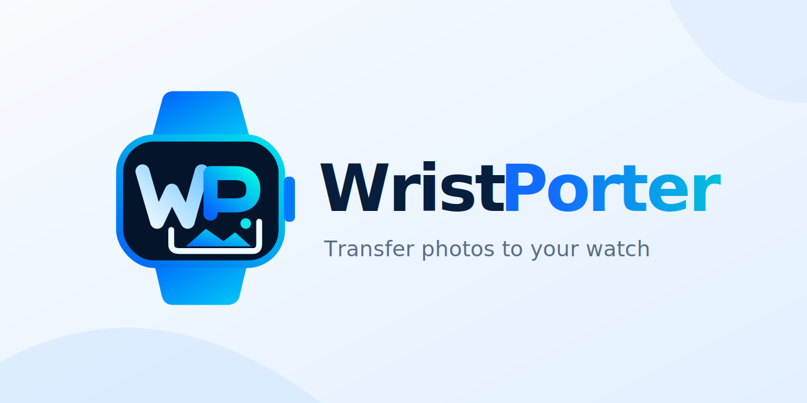
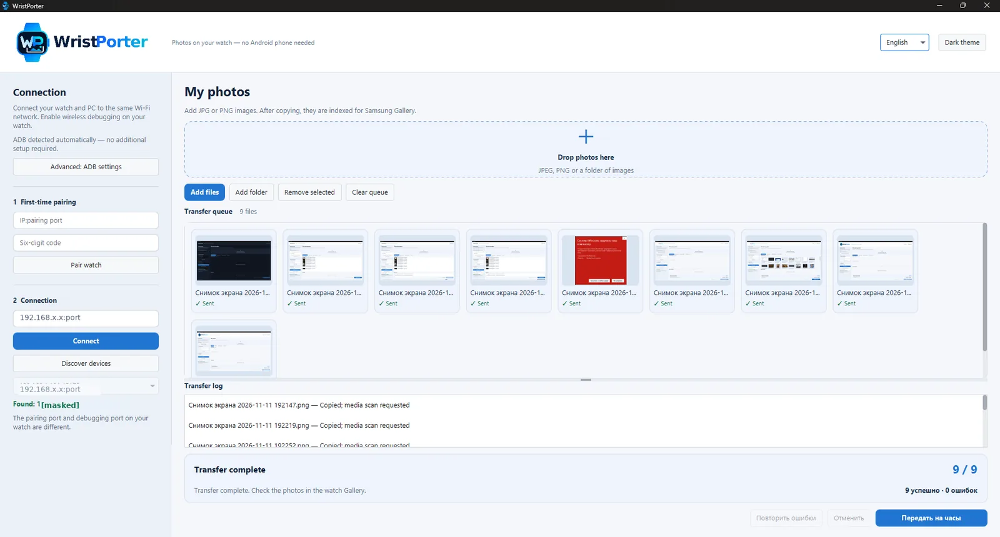

# WristPorter — Send photos from Windows to Wear OS

  

[**English**](README.md) · [Русский](README.ru.md)

**Send JPEG and PNG photos from your Windows PC directly to your Wear OS watch over Wi-Fi.** On the tested Galaxy Watch4 Classic, the photos appear in Samsung Gallery. No cable, cloud account or phone app is needed for the transfer.

**[Download WristPorter for Windows](https://github.com/aidarnig/WristPorter/releases/latest)** · [Quick start](docs/QUICK_START.md) · [Compatible watches](docs/COMPATIBILITY.md)

The app is free and open source. The Windows portable ZIP includes Java and ADB, so you don't need to install Android Studio or a separate Java runtime.

## Screenshots

## Why I made it

I switched from a Samsung phone to an iPhone and lost the usual way to send photos to my Galaxy Watch. I still wanted those pictures in the watch's Gallery. WristPorter was my solution: choose photos on my Windows PC, connect to the watch over Wi-Fi, and send them.

**Have an iPhone now?** You can use WristPorter for transfers to an *already set-up* compatible watch, even if you no longer use an Android phone. It does **not** pair a Galaxy Watch with an iPhone or replace the Android phone required for initial setup on many Galaxy Watch models.

## How it works

1. Enable **Developer options → ADB debugging → Wireless debugging** on your watch.
2. Pair and connect from WristPorter using the watch's Wi-Fi address and ports. Pairing and connection ports are different.
3. Add JPG/PNG files or folders (drag and drop works too), then select **Send to watch**.
4. Open Gallery on your watch. WristPorter requests media indexing after copying; Gallery visibility depends on your watch and its gallery app.

[Step-by-step setup guide](docs/QUICK_START.md).

## Watch compatibility

WristPorter uses Android's wireless ADB rather than a Samsung-only transfer protocol. Other Wear OS watches **may** work if they provide wireless debugging, but the full photo-to-Gallery workflow has only been tested on the reference device.

| Watches | Status |
| --- | --- |
| **Samsung Galaxy Watch4 Classic** | **Tested:** pairing, transfer and photos visible in Samsung Gallery |
| Other Samsung Galaxy Watch models running Wear OS | Potential compatibility — not tested |
| Google Pixel Watch, OnePlus Watch, Xiaomi Watch, TicWatch, OPPO Watch X and other Wear OS families | Potential compatibility — not tested |

Wireless ADB connectivity does **not** guarantee that a particular Gallery app will display transferred images. Older Samsung watches running Tizen, Apple Watch and watches on non-Wear OS platforms are not supported.

See [the compatibility list and requirements](docs/COMPATIBILITY.md). **Tried WristPorter on a different watch?** [Share your result](https://github.com/aidarnig/WristPorter/issues/new?template=watch-compatibility.yml).

## Features

- Send multiple JPG/PNG photos at once, or import a whole folder.
- Preview images before sending them.
- Pair and discover devices in the app; no terminal commands required.
- Track each transfer, cancel a batch and retry failed operations.
- Switch between English and Russian, light and dark mode.

## Download and setup

1. Go to [the latest release](https://github.com/aidarnig/WristPorter/releases/latest) and download the **WristPorter-…-windows-x64.zip** file under **Assets** (not GitHub's *Source code* ZIP).
2. Extract the **entire archive**. Open the WristPorter folder and run **WristPorter.exe**.
3. Follow the [Quick start](docs/QUICK_START.md) to connect your watch.

**Requirements:** Windows x64, a previously configured Wear OS watch with wireless ADB enabled, and a Wi-Fi network that allows your PC and watch to reach each other. The working reference setup is Windows and Galaxy Watch4 Classic; other hardware and clean Windows installations have not all been verified.

The app runs locally, with no account or telemetry. When you're done, **turn off wireless debugging** on the watch.

**Windows SmartScreen:** WristPorter is not yet signed with a trusted publisher certificate. Download only from this repository, verify the ZIP's SHA-256 against the supplied checksum and read the [security notes](docs/SECURITY.md). Do not disable Windows security features to run it.

## Development and feedback

- [Build from source](docs/DEVELOPMENT.md) · [Architecture](docs/ARCHITECTURE.md) · [Quality and test scope](docs/QUALITY.md)
- [Contributing](CONTRIBUTING.md) · [Issues](https://github.com/aidarnig/WristPorter/issues) · [Report watch compatibility](https://github.com/aidarnig/WristPorter/issues/new?template=watch-compatibility.yml)
- **Planned (not released):** [WristPorter Bridge development roadmap](docs/ROADMAP.md) · [Watch ↔ iPhone feature feasibility](docs/BRIDGE_CAPABILITIES.md) · [Engineering standard](AGENTS.md)

WristPorter is licensed under [MIT](LICENSE) and is not affiliated with Samsung, Google or any watch manufacturer.
