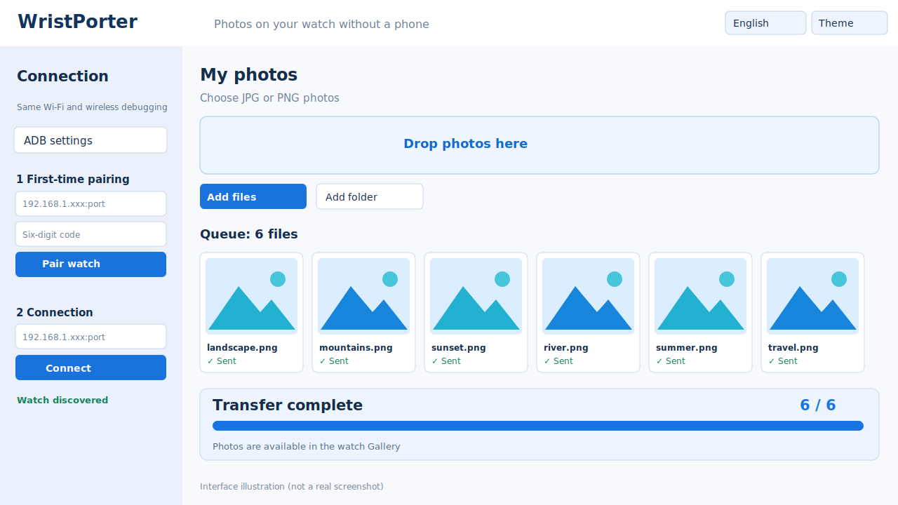

# WristPorter

[**English**](README.md) · [Русский](README.ru.md)


**Transfer photos to your smartwatch without an Android phone.** WristPorter is an independent open-source JavaFX desktop utility for Windows and compatible Wear OS watches. The reference device is Samsung Galaxy Watch 4 Classic.

## Download

**[Download the latest Windows portable ZIP from Releases](https://github.com/aidarnig/WristPorter/releases/latest)**

Choose `WristPorter-1.1.0-windows-x64.zip` under **Assets** — not the auto-generated **Source code** ZIP. Extract the complete archive and double-click `WristPorter.exe` inside the `WristPorter` directory. Java, JavaFX and ADB (including Windows DLLs) are already bundled. No installer, phone companion or Android Studio is needed after the watch has been set up.

## What it does

- Pair and connect to your watch via wireless ADB, with automatic watch discovery.
- Select JPEG/PNG files, entire folders, or drag and drop photos onto the queue.
- Preview thumbnails in an adaptive multi-column gallery.
- Transfer batches with a prominent progress bar and per-photo results; automatically ask Samsung Gallery to scan copied files.
- Retry failed copies and rescan already copied photos without duplicating uploads.
- Switch **English / Русский** and **light / dark** appearance without restarting. Both preferences are saved.

## Interface



*Illustration of the 1.1.0 interface, not a real screenshot. Real device and connection details are intentionally omitted.*

## First-time connection

On the watch, enable Developer options and **Wireless debugging**. Use **Pair device with pairing code**, enter its pairing port and six-digit code in WristPorter, then connect using the **different debugging port** shown on the watch. For details, see [Quick start](docs/QUICK_START.md). Turn wireless debugging off when finished.

## Development

Requires JDK 25 and Maven 3.9+ to build from source:

```bash
mvn -B -ntp verify
mvn -B -ntp -pl watch-desktop -am install
mvn -pl watch-desktop javafx:run
```

Technical decisions: [Architecture](docs/ARCHITECTURE.md) · [UX](docs/UX.md) · [Quality](docs/QUALITY.md) · [Development](docs/DEVELOPMENT.md) · [CI](docs/CI.md) · [Roadmap](docs/ROADMAP.md) · [Branding](docs/BRANDING.md) · [Issues](https://github.com/aidarnig/WristPorter/issues).

MIT licensed. Not affiliated with Samsung or Google. The user-confirmed Galaxy Watch 4 Classic photo-transfer scenario is supported; other watches and network conditions have not all been verified.
