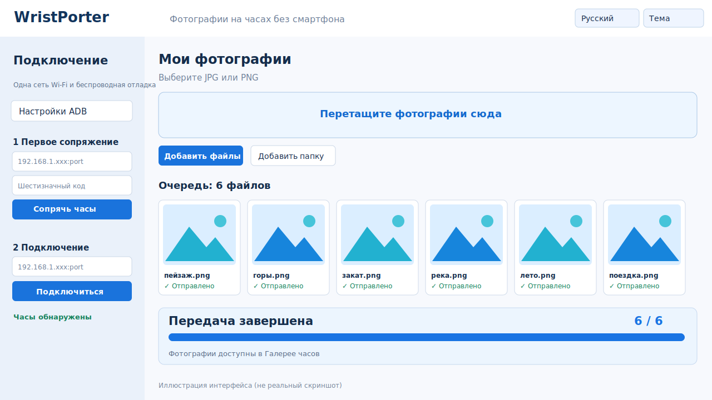

# WristPorter

[English](README.md) · [**Русский**](README.ru.md)


**Передавайте фотографии на умные часы напрямую с компьютера, без Android-смартфона.** WristPorter — бесплатное приложение с открытым исходным кодом для Windows и совместимых часов Wear OS. Основная проверенная модель — Samsung Galaxy Watch 4 Classic.

## Скачать

**[Скачать актуальную portable-версию из GitHub Releases](https://github.com/aidarnig/WristPorter/releases/latest)**

В разделе **Assets** выберите `WristPorter-1.1.0-windows-x64.zip`, а не автоматически созданный GitHub архив **Source code**. Полностью распакуйте ZIP и запустите `WristPorter.exe` из папки `WristPorter`. Java, JavaFX и ADB со всеми необходимыми DLL уже входят в комплект. Не нужны установщик, Android Studio или приложение на смартфоне после первоначальной настройки часов.

## Возможности

- Сопряжение и подключение часов по Wi-Fi через ADB, обнаружение устройств после перезапуска.
- Выбор JPEG/PNG, целых папок и перетаскивание файлов.
- Просмотр фотографий в адаптивной сетке миниатюр.
- Отправка пачки изображений с крупным прогресс-баром и результатом по каждому файлу; автоматическое обновление Samsung Gallery.
- Повтор неудачных операций без лишнего копирования уже загруженных изображений.
- Переключение **Русский / English** и **светлой / тёмной темы** без перезапуска с сохранением настроек.

## Интерфейс



*Иллюстрация интерфейса версии 1.1.0, а не реальный скриншот. Личные данные и адреса устройств не используются.*

## Первое подключение

На часах включите параметры разработчика и **Беспроводную отладку**. Выберите **Сопряжение с помощью кода**, введите в WristPorter порт сопряжения и шестизначный код, затем подключитесь через **другой порт отладки**, указанный на часах. Подробности — в [инструкции](docs/QUICK_START.md). После работы рекомендуется отключать беспроводную отладку.

## Для разработчиков

Для сборки из исходников потребуются JDK 25 и Maven 3.9+:

```bash
mvn -B -ntp verify
mvn -B -ntp -pl watch-desktop -am install
mvn -pl watch-desktop javafx:run
```

Технические документы: [Архитектура](docs/ARCHITECTURE.md) · [UX](docs/UX.md) · [Тестирование](docs/QUALITY.md) · [Разработка](docs/DEVELOPMENT.md) · [CI](docs/CI.md) · [План](docs/ROADMAP.md) · [Брендинг](docs/BRANDING.md) · [Задачи](https://github.com/aidarnig/WristPorter/issues).

Лицензия MIT. Проект независимый и не связан официально с Samsung или Google. Основной сценарий проверен на Galaxy Watch 4 Classic; работа на других часах и в нестандартных сетях не гарантируется.
